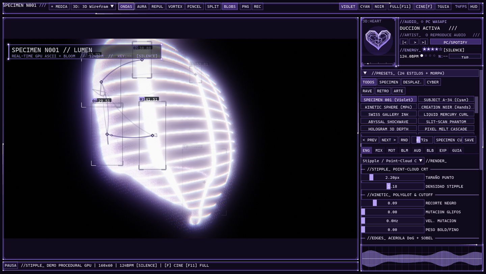
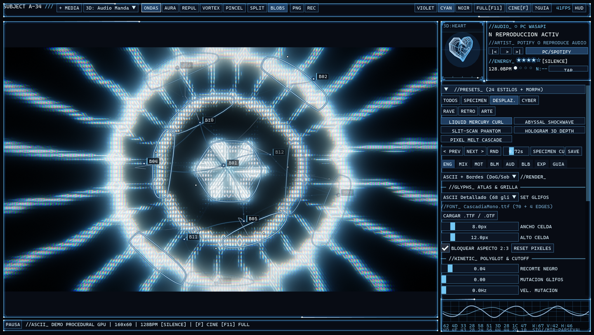
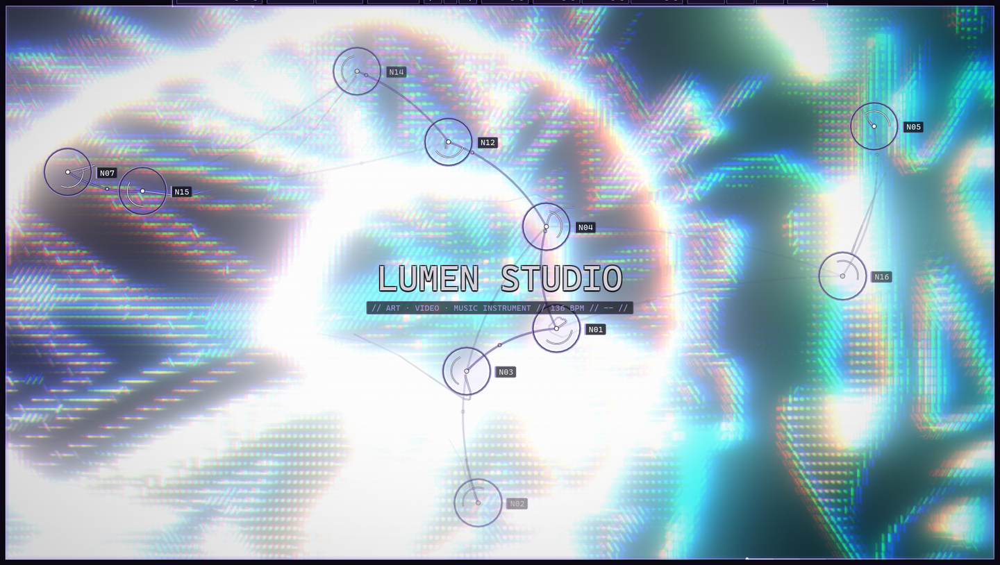
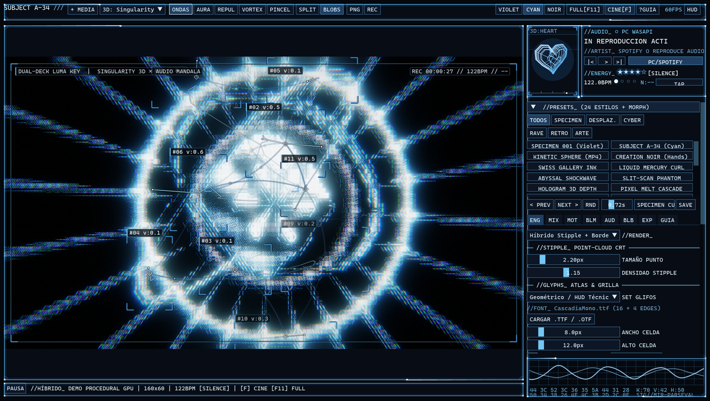
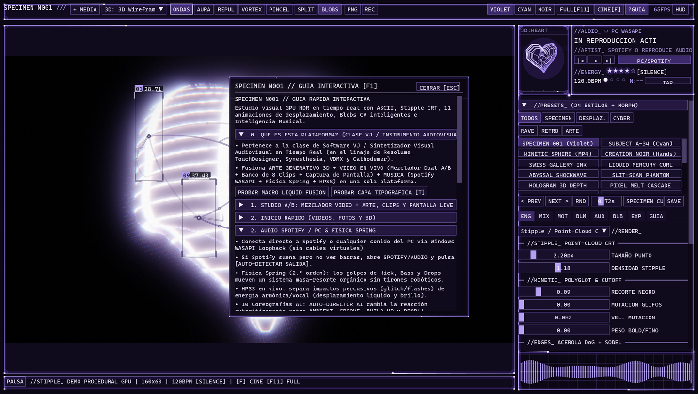
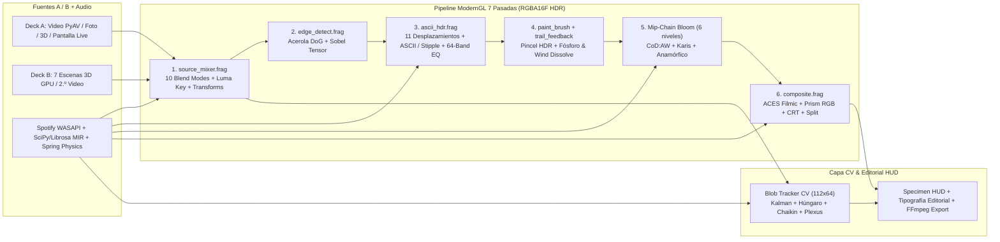

<div align="center">

# SPECIMEN N001 // LUMEN ASCII BLOOM STUDIO

**Real-Time GPU Audiovisual Instrument · VJ Visual Synthesizer · Art × Video × Music Platform**

[](https://www.python.org/)
[](https://moderngl.readthedocs.io/)
[](https://librosa.org/)
[](https://pthom.github.io/imgui_bundle/)
[](LICENSE)

*Transforma videos, imágenes, captura de pantalla en vivo y escenas 3D procedurales en animaciones **ASCII + Stipple CRT + HDR Bloom** reactivas a **Spotify y al audio de tu PC**, con **Mezclador Dual-Deck A/B**, **11 desplazamientos GPU**, **24 presets** y **Blob Tracking por Visión por Computador**.*

<br/>



</div>

---

## Galería Visual

<table>
  <tr>
    <td width="50%" align="center">
      
      <br/><sub><b>SUBJECT A-34 (Cyan)</b> · Liquid Curl Flow + Audio Mandala EQ + Organic Contour Blobs</sub>
    </td>
    <td width="50%" align="center">
      
      <br/><sub><b>Modo Cine 100%</b> · Kaleido Rave Prism + Fusión Aditiva A/B + Constellation Nodes + Poster Tipográfico</sub>
    </td>
  </tr>
  <tr>
    <td width="50%" align="center">
      
      <br/><sub><b>STUDIO A/B Luma Key</b> · Singularity 3D × Audio Mandala + Hybrid Circuit + Cyber Targeting Pro</sub>
    </td>
    <td width="50%" align="center">
      
      <br/><sub><b>Guía Interactiva Integrada [F1]</b> · Explicación en vivo con botones de prueba directa</sub>
    </td>
  </tr>
</table>

---

## ¿Qué clase de plataforma es LUMEN Studio?

**LUMEN ASCII BLOOM STUDIO** pertenece a la clase de **Software VJ / Instrumento Audiovisual en Tiempo Real y Sintetizador Visual Generativo**, fusionando **ARTE + VIDEO + MÚSICA** en un solo entorno GPU inspirado en cuatro referentes de la industria:

| Pilar | Linaje | Qué incluye en LUMEN Studio |
| :--- | :--- | :--- |
| **Mezclador VJ & Media Server** | *Resolume · VDMX* | Mezclador GPU **Dual-Deck A/B** con 10 *Blend Modes* + *Luma Key*, **Banco de 8 Clips**, **Captura de Pantalla Live** y **6 Macros de Escena (`S1–S6`)** |
| **Visualizador Audio-Reactivo** | *Synesthesia · MilkDrop* | Motor MIR (`SciPy` + `Librosa`), física de resortes de 2.º orden (**Spring-Damper**), separación **HPSS**, reloj BPM PLL y **10 Coreografías AI** |
| **Arte Generativo & Visión CV** | *TouchDesigner* | **11 animaciones de desplazamiento GPU** (*Curl Noise*, *Slit-Scan*, *3D Parallax*, *Kaleido*), **Blob Tracking CV real** (Kalman + Húngaro + Plexus) y física de cursor |
| **Sintetizador Visual Retro-HDR** | *Cathodemer* | Motores **ASCII+Sobel**, **Stipple CRT**, **Híbrido**, Mip-Chain Bloom de 6 niveles, *Kinetic Polyglot Scramble* y **Tipografía Editorial Viva** |

---

## Arquitectura del Pipeline GPU HDR (`RGBA16F`)



---

## Funcionalidades Destacadas

### 1. STUDIO A/B — Fusión ARTE × VIDEO × MÚSICA (`MIX`)
- **Mezclador Dual-Deck GPU ([shaders/source_mixer.frag](shaders/source_mixer.frag))**: fusiona en vivo **Deck A** (Video, Imagen, 3D o Captura de Pantalla) con **Deck B** (cualquiera de las **7 Escenas 3D Generativas** o un **2.º Video/Imagen**) mediante **10 Modos de Fusión**: `Crossfade`, `Additive`, `Screen`, `Multiply`, `Difference`, `Luma Key B→A`, `Luma Key A→B`, `Lighten`, `Exclusion` y `Beat Strobe Cut [V]`.
- **Crossfader reactivo al audio**: los impactos de *Kick/Drop* empujan el arte generativo de Deck B sobre tu video con física Spring.
- **Captura de Pantalla en Vivo (`[L]`)**: captura en hilo secundario cualquier pantalla o región (*Completa*, *Mitad Izq.*, *Mitad Der.*, *Centro 16:9*) directo a Deck A (ideal para Spotify Canvas, YouTube, juegos u otras apps).
- **Banco VJ de 8 Clips + Auto-Director**: arrastra múltiples clips o pulsa `+ AÑADIR CLIPS`, asígnalos a `[A]`/`[B]` y activa **Auto-Clip en Drops**, cambio automático cada **4 / 8 / 16 compases** y **Beat Speed Boost**.
- **Customización Pro de Video**: Encuadre (`Fill / Contain / Cover`), Escala (`0.5×–2.5×`), Rotación (`-180°..+180°`), Flip H/V, Simetría Espejo (`H / V / 4×`) y Pre-Grade (*Hue / Contraste / Saturación*).
- **Capa Artística Tipográfica (`[T]`)**: 4 estilos editoriales (*Specimen Editorial Stamp*, *Kinetic Center Poster*, *Cinema Ticker Ribbon*, *Gallery Frame + Timecode*) alimentados por **Spotify en vivo** o texto personalizado.
- **6 Macros de Performance (`S1–S6`)**: dispara o guarda tu configuración completa de *Preset + Desplazamiento + Mezcla A/B + Estilo Blob + Coreografía Audio + Tema + Tipografía* en 1 clic.

### 2. Motor de Inteligencia Musical (`SciPy` + `Librosa` + `Spring Physics`)
- **Spotify & Audio del PC directo (sin cables virtuales)**: captura en vivo por **Windows WASAPI Loopback** (`PyAudioWPatch`) con auto-detección de salida activa + control y metadatos de **Spotify Desktop** (`|<`, `▶/⏸`, `>|`) vía Windows GSMTC.
- **Física de Resortes de 2.º Orden (`SpringDamper`)**: convierte transitorios en movimiento orgánico con peso e inercia ajustable (`FISICA SPRING`).
- **Separación Streaming HPSS + 5 Stems Parseval + AGC**: separa energía *Percusiva* vs *Armónica*, *Kick*, *Bass*, *Snare*, *Vocals*, *Hi-Hat*, *Spectral Rolloff (85%)*, *Chroma de 12 semitonos (`C..B`)*, reloj **BPM PLL 4/4** y detector de **`SILENCE / AMBIENT / GROOVE / BUILD-UP / DROP!!`**.
- **10 Coreografías Musicales**: desde `AUTO-DIRECTOR AI` hasta `LIQUID DISPLACEMENT FLOW` y `KALEIDO PRISM HYPNOTIC`.

### 3. 11 Animaciones de Desplazamiento GPU (`MOT` / Tecla `M`)
1. **Liquid Curl Flow** (ruido Curl libre de divergencia $\nabla \times \Psi$)
2. **Acoustic Shockwave** (ondas radiales de presión sincronizadas al beat)
3. **Silk Wave Drift** (ondas armónicas cruzadas X/Y)
4. **Slit-Scan Echo** (cintas temporales estilo TouchDesigner)
5. **3D Depth Parallax** (profundidad 2.5D orbital por luminancia)
6. **Cyber Glitch Blocks** (bloques *datamosh* disparados por *snares*)
7. **Vortex Singularity** (remolino logarítmico armónico)
8. **Prism RGB Split** (dispersión cromática rotatoria en composición HDR)
9. **Kaleido Mirror Drift** (simetría polar rotatoria estilo VJ)
10. **Elastic Lens Bounce** (lente elástica con física Spring)
11. **Pixel Sort Cascade** (cascada vertical *pixel melt*)

### 4. 24 Presets Curados + Blob Tracking CV Inteligente
- **24 Presets** filtrables por categoría (`SPECIMEN`, `DESPLAZ.`, `CYBER`, `RAVE`, `RETRO`, `ARTE`) con transición **Morph** suave y guardado a `.json`.
- **Blob Tracking Real ([src/blob_tracker.py](src/blob_tracker.py))**: 4 motores de detección (*Híbrido*, *Highlights*, *Motion Diff*, *Bordes Sobel*), partición Voronoi de picos locales, tracking **Kalman + Algoritmo Húngaro**, contornos **Chaikin**, red **Plexus Bézier** y **5 estilos visuales** (`TouchDesigner Plexus`, `Swiss Minimal`, `Organic Contour`, `Constellation Nodes`, `Cyber Targeting Pro`).
- **Exportación Profesional FFmpeg**: capturas **PNG**, video **MP4 (H.264 con audio original)**, **GIF HD** y **WebM (VP9)** + **Hot-Reload GLSL** en vivo (`[F5]`).

---

## Instalación y Uso Rápido

### Requisitos
- **Windows 10/11** (recomendado para WASAPI Loopback y Spotify GSMTC), **Python 3.10+** y GPU compatible con **OpenGL 3.3+**.
- **FFmpeg** instalado en el `PATH` (opcional, requerido solo para exportar MP4/GIF/WebM).

### Instalación
```powershell
git clone https://github.com/TheChosenOneReturns/lumen-ascii-bloom-studio.git
cd lumen-ascii-bloom-studio
python -m venv .venv
.\.venv\Scripts\python.exe -m pip install -r requirements.txt
```

### Ejecución
Haz doble clic en **`launch_studio.bat`** o ejecuta:
```powershell
.\.venv\Scripts\python.exe run.py
```
> **Consejo:** Pulsa **`F1`** dentro de la app para abrir la **Guía Interactiva Rápida** con botones de demostración en 1 clic, o arrastra cualquier video/imagen/fuente `.ttf` directamente sobre la ventana.

---

## Atajos de Teclado

| Tecla | Acción |
| :--- | :--- |
| **`F1`** | Abrir / Cerrar **Guía Interactiva Rápida** |
| **`F`** / **`F11`** / **`Esc`** | **Modo Cine 100%** / Pantalla Completa / Salir |
| **`M`** | Alternar las **11 Animaciones de Desplazamiento GPU** |
| **`V`** | Alternar los **10 Modos de Fusión A/B** (*Blend / Luma Key / Beat Strobe*) |
| **`T`** | Alternar la **Capa Tipográfica Artística** (4 estilos editoriales) |
| **`L`** | Activar / Detener **Captura de Pantalla en Vivo** hacia Deck A |
| **`P`** | Siguiente Preset con transición Morph |
| **`X`** / **`B`** | **Blob Tracking CV** ON-OFF / Alternar los **5 Estilos Visuales** |
| **`D`** | Disparar explosión manual **DROP!!** |
| **`Tab`** / **`H`** | Deslizar Dossier HUD / Mini-HUD flotante de Spotify en Cine |
| **`Espacio`** | Play / Pausa |
| **`S`** / **`R`** / **`C`** | Cortina Split-Screen / Reset Vista / Limpiar Estelas y Pintura |
| **`1` – `6`** | Modo cursor (Ondas, Aura, Repulsión, Vórtice, Pincel HDR, Off) |
| **`←` / `→`** | Paso frame a frame (en pausa) |
| **`F5`** | Hot-Reload en vivo de shaders GLSL |

---

## Estructura del Proyecto

```text
├── run.py                      # Punto de entrada principal
├── launch_studio.bat           # Lanzador rápido en Windows
├── requirements.txt            # Dependencias congeladas
├── docs/images/                # Capturas de exhibición
├── shaders/                    # 10 shaders GLSL 330 core (Hot-Reload)
│   ├── fullscreen.vert
│   ├── procedural_demo.frag    # 7 escenas 3D GPU (Mandala EQ, Heart, Sphere...)
│   ├── source_mixer.frag       # Mezclador Dual-Deck A/B + 10 Blends + Luma Key
│   ├── edge_detect.frag        # Acerola DoG + Sobel Structure Tensor
│   ├── ascii_hdr.frag          # 11 Desplazamientos + ASCII / Stipple / Hybrid
│   ├── paint_brush.frag        # Pincel emisivo HDR ping-pong
│   ├── trail_feedback.frag     # Persistencia fósforo + Wind Dissolve
│   ├── bloom_*.frag            # Mip-Chain Bloom 6 niveles (CoD:AW + Karis)
│   └── composite.frag          # ACES Filmic + Prism RGB + CRT + Split-Screen
└── src/
    ├── studio_app.py           # Aplicación principal Specimen HUD (8 pestañas)
    ├── gpu_pipeline.py         # Orquestador ModernGL RGBA16F (7 pasadas)
    ├── video_studio.py         # Dual-Deck Mixer, 8-Slot Clip Bank, Screen Grab, Macros
    ├── music_intelligence.py   # MIR SciPy/Librosa, SpringDamper, HPSS, Chroma, BPM PLL
    ├── audio_engine.py         # Captura WASAPI Loopback + Watchdog auto-salida
    ├── spotify_bridge.py       # Integración en vivo Spotify Windows GSMTC
    ├── blob_tracker.py         # CV Blob Tracker (Kalman + Húngaro + Chaikin + Plexus)
    ├── specimen_ui.py          # Renderizador HUD animado + Blobs + Tipografía Artística
    ├── presets.py              # 24 presets curados en 6 categorías + gestor JSON
    ├── glyph_atlas.py          # Generador dinámico de atlas de glifos + fuentes TTF
    ├── media_engine.py         # Decodificador PyAV / Pillow (A-B loop, scrubbing)
    ├── interaction.py          # Física interactiva de ondas, vórtice y pincel
    ├── exporter.py             # Exportador determinista FFmpeg (PNG/MP4/GIF/WebM)
    └── config.py               # Parámetros globales y PresetMorpher
```

---

## Licencia

Distribuido bajo licencia **MIT**. Consulta [LICENSE](LICENSE) para más detalles.
